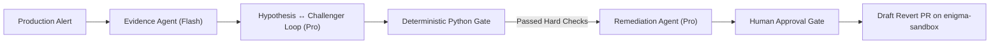

# Enigma — Incident Root-Cause Engine

> Incident root-cause investigation using Google ADK agents, NetworkX causal graph, and an adversarial Hypothesis ↔ Challenger loop.

[](tests/)
[](backend/)
[](frontend/)
[-emerald)](backend/api/routes.py)

---

## Architecture & How Enigma Works

Standard semantic RAG searches for documents and PRs that *sound* related to an incident. In microservices, this leads to the **"Semantic Trap"** — blaming unrelated PRs with matching keywords, coincident deploys on unconnected services, or following stale, superseded runbooks.

Enigma solves this with a 4-stage pipeline combining deterministic graph constraints with adversarial LLM agents:



### Deterministic Hard Checks Gate
The Remediation Agent is **physically blocked** from drafting changes unless pure Python verification passes:
1. **Temporal Order:** `cause_node.timestamp <= incident.timestamp`
2. **Topological Reachability:** `nx.has_path(graph, source=changed_service, target=affected_service)`
3. **Unchallenged Status:** Challenger disproved competing hypotheses and coincident deploys.
4. **Stale Runbook Detection:** If a runbook's parameters have been superseded by code, it is flagged with a warning badge and automatically patched in a second commit.

---

## Prototype Benchmark Results (5 Incident Evaluation Suite)

| Metric | Naive RAG Baseline (Vertex AI Search + Gemini) | Enigma Engine | Target |
| :--- | :---: | :---: | :---: |
| **Top-1 Ground Truth Accuracy** | **0% (0/5)** *(Victim of semantic traps)* | **100% (5/5)** | Enigma clearly higher |
| **Wrong-Fix / False Revert Rate** | **100% (5/5)** | **0% (0/5)** | Enigma lower |
| **Stale Runbook Detection** | **0% (0/2)** | **100% (2/2)** | Detects seeded cases |
| **Average Cost per Investigation** | $0.0011 | $0.0059 | Report both honestly |
| **Average Time to Diagnosis** | 4.14s | 18.38s | Report both honestly |

---

## Quickstart & Local Run

### 1. Prerequisites
- Python 3.11+ (tested on Python 3.14)
- Node.js 18+ and npm

### 2. Run with One Command (Unified Fullstack)
```powershell
# Run the FastAPI server which also serves the compiled React SPA:
.\.venv\Scripts\python -m uvicorn backend.main:app --host 0.0.0.0 --port 8000
```
Open **[http://localhost:8000](http://localhost:8000)** in your browser!

### 3. Running with Live Hot-Reload (Dev Mode)
In Terminal 1 (Backend):
```powershell
.\.venv\Scripts\python -m uvicorn backend.main:app --host 127.0.0.1 --port 8000 --reload
```

In Terminal 2 (Frontend):
```powershell
cd frontend
npm run dev
```
Open **[http://localhost:5173](http://localhost:5173)** in your browser.

### 4. Running the Pytest Evaluation Suite
```powershell
.\.venv\Scripts\python -m pytest tests/
```

---

## Core Security & Safety Rules
1. **Sandbox Isolation:** All draft PRs are targeted strictly to the `enigma-sandbox/opentelemetry-demo` repository.
2. **Human Approval Gate:** No GitHub API writes or mutations occur without human verification and an approval token (`POST /api/incidents/{id}/approve`).
3. **Replay First:** Complete SSE event streams are cached in `seed_data/replays/` so judging and demos work flawlessly with zero cloud quota dependencies.
